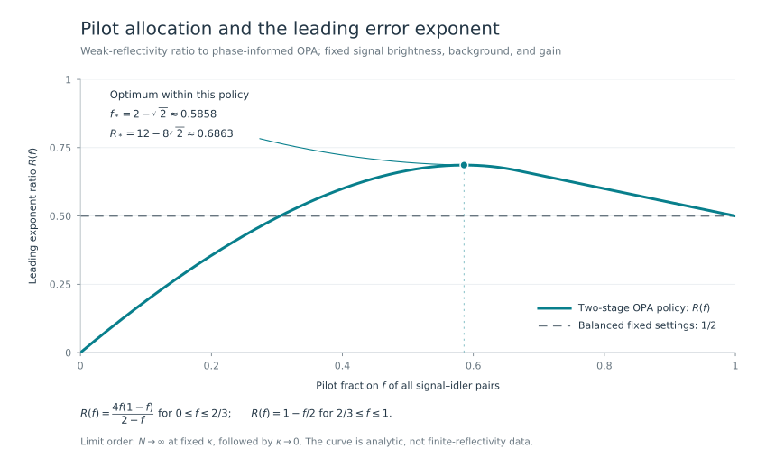

# Quantum Illumination Feedback

**One classical phase update gives a strict quantum-illumination advantage after every phase-learning use is counted.** The receiver processes each return–idler pair separately, learns an unknown static return phase from early photon counts, and uses the complete pilot and main-stage record to decide whether a target is present.

Phase learning followed by local reception is an established idea. The result here is its full-record detection reliability law for a specified one-output optical-parametric-amplifier (OPA) receiver. Rare misleading pilot records are included explicitly; replacing the learned phase by its typical value would miss the calibration cost.

## Principal results

Let $N$ be the total number of signal–idler pairs. Each signal has mean occupation $n$, the return background has occupation $B$, and the power reflectivity is $\kappa$. The return phase is unknown but constant across all $N$ uses. All other model parameters are known.

The worst-phase symmetric error has a large-sample exponent $E_\kappa$: its exponential scale is $\exp(-NE_\kappa)$. The [exact transcript theorem](science/error_exponent.md) proves existence of that exponent and gives an attaining likelihood test using all observations.

| Result | What is established |
|---|---|
| Paid feedback advantage | At $n=0.001$, $B=10$, and the specified fixed gain and pilot fraction, $E_\kappa>1.1926\,\kappa nC_B$ for every fixed $0<\kappa\le0.1$. |
| Strong classical comparison | $\kappa nC_B$, with $C_B=(\sqrt{B+1}-\sqrt B)^2$, is the optimal exponent for fixed classical mixtures of coherent signals at the same total mean signal energy, even with the true phase and arbitrary global reception. |
| Solved pilot allocation | In the weak-reflectivity limit, the optimal pilot fraction within this policy is $f_*=2-\sqrt2\approx58.6\%$. |
| Failure of sublinear pilots | If the receiver uses $o(N)$ fixed-brightness pilots and then freezes one counted OPA output at the learned phase, its worst-phase error exponent is zero, regardless of the final classical decision rule. |

The first row is a **global analytic certificate at nonzero reflectivity**, evaluated with exact rational interval arithmetic. It concerns an asymptotic exponent in $N$, rather than a finite-sample error probability with its prefactor omitted. See [the finite-reflectivity proof](science/finite_reflectivity.md) and [the classical converse](science/classical_limit.md).

## The feedback law

For a fixed OPA gain $G>1$, write

$$
q=Gn+(G-1)(B+1),
\qquad
J_G=\frac{4G(G-1)n(n+1)}{q(1+q)}.
$$

At a fixed positive pilot fraction $f$, the exponent satisfies

$$
E_\kappa(f,G)=\frac{\kappa J_G}{8}R(f)+O(\kappa^{3/2}),
$$

$$
R(f)=
\begin{cases}
\dfrac{4f(1-f)}{2-f},&0<f\le2/3,\\[4pt]
1-f/2,&2/3\le f<1.
\end{cases}
$$

The large-sample limit is taken first, followed by $\kappa\downarrow0$ with $n,B,G,f$ fixed. The maximum retains $12-8\sqrt2\approx68.6\%$ of the phase-informed OPA exponent. Two balanced predetermined settings retain $50\%$ at leading order.



At the finite brightnesses $n=0.001$ and $B=10$, the optimized leading quantum/classical ratio is $1.2339558846\ldots$. The [gain calculation](science/finite_reflectivity.md) and the [allocation proof](science/error_exponent.md) specify the optimization domain. Neither optimizes over all adaptive quantum receivers.

## Why calibration must be counted

If all pilot counts are zero, the declared estimator chooses the same pump phase for every sample size. One fixed target phase then makes the entire main-stage count distribution exactly equal to the target-absent distribution. With $o(N)$ pilots, that shared record has probability $\exp[-o(N)]$, preventing a positive worst-phase exponent. The [pilot theorem](science/pilot_cost.md) accounts for the unequal probabilities of that record under both hypotheses and permits every final decision rule.

With a positive pilot fraction, the [complete-transcript proof](science/error_exponent.md) controls all rare pilot outcomes on the same exponential scale as detection. It handles unbounded photon counts, the estimator's origin, the count lattice, and a phase fixed independently of sample size.

## Read the science

Start with the [scientific route](science/README.md), or go directly to the question that matters:

| To inspect | Read |
|---|---|
| State, channel, exact count law and charged resources | [Model](science/model.md) |
| Transcript likelihood, minimax exponent and allocation law | [Error exponent](science/error_exponent.md) |
| Global fixed-reflectivity certificate and gain optimization | [Finite reflectivity](science/finite_reflectivity.md) |
| Classical mixtures, arbitrary energy randomization and global receivers | [Classical limit](science/classical_limit.md) |
| The exact rare-event obstruction to vanishing pilots | [Pilot cost](science/pilot_cost.md) |
| Physical meaning and boundaries | [Interpretation](science/interpretation.md) |
| Prior receiver proposals and inherited proof ingredients | [Related work](references/RELATED_WORK.md) and [bibliography](references/references.bib) |

[The reading guide](llms.txt) maps common questions to the authoritative files.

## Reproduce the certificate

From the repository root:

```bash
python3 verification/run_all.py
```

The required certificate uses only Python's standard library. Its inequalities compare exact rational endpoints, including outward-rounded square roots. [Verification instructions](verification/README.md) also explain the optional exact-rate numerical minimization and plot generation. Numerical searches corroborate the written rate analysis; the strict separation follows from the global analytic bound and its rational evaluation.

## Scope

The phase stays constant throughout the experiment. Reflectivity, brightness, background and gain are known; idler preservation, mode matching, local pump stability and photon counting are ideal. The receiver needs ordinary idler storage over the target round trip, while requiring no quantum coherence between different pairs. Every pilot signal use and its mean energy are included. The classical comparator is a fixed transmitter chosen before target interaction.

The result concerns transmitted-energy detection exponents. It does not price a complete apparatus, establish a wall-clock advantage, or cover phase drift. The sublinear-pilot theorem is specific to one frozen phase and one counted OPA output; other adaptive receivers can have different behavior.

## Purpose and contact

This repository serves as a record of the work and a guide for the author’s self-directed learning. For discussion or potential collaboration, please contact Ruge Lin at [gogoko699@gmail.com](mailto:gogoko699@gmail.com).
