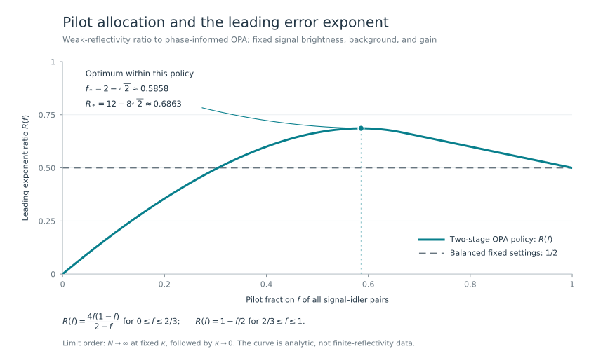

# From Shapiro's receiver to paid phase feedback

[Learning route](README.md) · [Milestone map](milestones.md#m01) · [Scientific account](../science/README.md)

A weak reflection can be difficult to distinguish from thermal light. Quantum illumination sends one part of a correlated signal–idler pair toward the target and keeps the other part at the receiver. The useful evidence is a correlation between the return and its idler. An optical parametric amplifier (OPA) can turn that correlation into a change in photon-count statistics.

The direction of the correlation depends on the return phase. This project asks what happens when the phase is unknown, early counts choose the setting for later measurements, and all those counts must contribute to one detection decision. The central issue is the probability of a misleading calibration record, including records far from the typical outcome.

## The selected source and where to read

The educational anchor is Jeffrey H. Shapiro, *The Quantum Illumination Story*, IEEE Aerospace and Electronic Systems Magazine **35**(4), 8–20 (2020), DOI [10.1109/MAES.2019.2957870](https://doi.org/10.1109/MAES.2019.2957870). Section and equation pointers below refer to [arXiv:1910.12277v4, revised 23 December 2019](https://arxiv.org/pdf/1910.12277v4).

| Source location | Connection |
|---|---|
| “Tan et al.'s Quantum Illumination,” Eqs. (8)–(14) | Modes, photon numbers, Gaussian moments, and the return–idler correlation. |
| “QI Receivers and Experiments,” prose preceding Eq. (15), then Eqs. (15)–(16) | OPA transformation, counted total, and conditional mean. |
| Eq. (17) and the following paragraph | Known-phase operating-regime exponent and idler/phase-matching assumptions. |
| Appendix B, especially Eq. (B3) | The two-mode squeezed-vacuum input. |

The adaptive likelihood and reliability arguments below are supplied by the project's scientific pages. The review gives the physical starting point; its known-phase exponent is not an adaptive calibration theorem.

## A notation map for the Gaussian-state sections

This map applies to the review's **Tan/OPA discussion**. Its opening Lloyd discussion uses a different pulse/mode organization.

| Shapiro's notation | Project notation | Meaning |
|---|---|---|
| $`M`$ | $`N`$ | Number of signal–idler mode pairs. |
| $`N_S`$ | $`n`$ | Mean signal photons per mode. |
| $`N_B`$ | $`B`$ | Return background occupation; distinguish it from the environment occupation below. |
| $`\kappa`$ | $`\kappa`$ | Power reflectivity; the field coefficient is $`\sqrt{\kappa}`$. |
| $`G`$ | $`G`$ | OPA intensity gain. |
| $`\hat a_{Im}^{\rm out}`$ | $`c_\phi`$ | Counted OPA output mode. |
| $`\hat N_T`$ | $`S_x,S_y,S_0`$ | Photon counts, separated here by measurement setting; these are not the pair number $`N`$. |

The project's additional variables are the unknown target phase $`\theta`$, the chosen pump phase $`\phi`$, and the pilot fraction $`f`$.

## One signal, one retained idler, one returned mode

For a bosonic mode, $`a^\dagger a`$ is its photon-number operator. Each input pair is a two-mode squeezed vacuum with mean occupation $`n`$ in both modes and the correlation

```math
\langle a_Sa_I\rangle=\sqrt{n(n+1)}.
```

The signal $`S`$ illuminates the target; the idler $`I`$ remains available for the joint pair measurement. Under absence, the return $`R`$ is thermal light independent of the idler. Under presence,

```math
a_R=e^{i\theta}\sqrt{\kappa}\,a_S+\sqrt{1-\kappa}\,a_E,
\qquad
\langle a_E^\dagger a_E\rangle=\frac{B}{1-\kappa}.
```

Consequently the returned occupation is $`B+\kappa n`$, and its correlation with the idler is $`e^{i\theta}\sqrt{\kappa n(n+1)}`$. The parameter $`\theta`$ rotates this correlation without changing the return brightness.

The environment occupation is chosen to keep the **return background** equal to $`B`$ under both hypotheses. With a vacuum signal, both hypotheses therefore produce the same returned thermal state. Holding the environment at occupation $`B`$ instead would give a returned background $`(1-\kappa)B`$ under presence and introduce a different detection mechanism: a background shadow. The finite-reflectivity result uses the explicit matched-background model, rather than silently dropping this distinction in a weak-reflection approximation. See [the exact channel assumptions](../science/model.md#signal-and-channel).

There is one unknown but **constant** phase for the whole experiment, and $`\kappa`$ is fixed and known. Early and late pairs experience the same phase. A phase independently redrawn between uses would not be learnable in this way; a random reflectivity with a specified fading distribution is also a different model. The review's later discussion around Eq. (22) allows random target parameters, but the present theorem does not average over such a fading law.

## The OPA turns a correlation into counts

The receiver combines each return only with its own retained idler. At pump phase $`\phi`$, it counts the output mode

```math
c_\phi=\sqrt G\,a_I+e^{i\phi}\sqrt{G-1}\,a_R^\dagger.
```

Expanding $`c_\phi^\dagger c_\phi`$ produces two occupation terms and a term proportional to the real part of the return–idler correlation. This is how the pump phase selects a direction. Define the scalar coefficients

```math
q=Gn+(G-1)(B+1),\qquad
b=2\sqrt{G(G-1)n(n+1)},\qquad
c=(G-1)n.
```

Here $`c`$ is a number, while $`c_\phi`$ is the mode operator. The photon-count mean is $`q`$ under absence and

```math
\mu_\theta(\phi)=q+b\sqrt{\kappa}\cos(\theta-\phi)+c\kappa
```

under presence. The $`B+1`$ term includes the bosonic commutator contribution; it is required even for a very weak input.

The counted mode is thermal. Its integer outcome $`K`$ has the exact geometric law

```math
p_\mu(k)=\frac{\mu^k}{(1+\mu)^{k+1}},\qquad k=0,1,2,\ldots,
\qquad \mathrm{Var}(K)=\mu(1+\mu).
```

Gaussian field quadratures therefore lead here to **geometric photon counts**. The full count distribution, rather than only its mean or a Gaussian approximation to frequent outcomes, is what enters the proof. The [model page](../science/model.md#one-pair-one-counted-output) derives the law and credits the inherited OPA receiver.

## The paid experiment and its exact decision

For a fixed fraction $`0\lt f\lt 1`$, use $`m_x=m_y=\lfloor fN/2\rfloor`$ pairs at pump phases $`0`$ and $`\pi/2`$. Their sample means are $`Z_x=S_x/m_x`$ and $`Z_y=S_y/m_y`$. Choose

```math
\widehat\phi=\mathrm{Arg}\big[(Z_x-q)+i(Z_y-q)\big],
```

with value zero when both centered means vanish. Measure the remaining $`m_0=N-m_x-m_y`$ pairs at that frozen phase and retain their sum $`S_0`$.

This rule is deliberately **unshifted**. Under presence, the typical centered pilot vector approaches

```math
b\sqrt{\kappa}(\cos\theta,\sin\theta)+c\kappa(1,1).
```

Its angle need not equal $`\theta`$ at fixed $`\kappa`$. The common offset is included in the exact likelihood; the argument does not assume that the chosen phase becomes the true phase. The offset is smaller than the correlation term in the weak-reflectivity limit.

Every pilot contributes both to the phase command and to the final target decision. Conditional on the pilot sums, the main counts are independent geometric variables at the commanded setting. Unconditionally, that setting depends on the earlier observations, so the entire experiment is not one iid sample at a fixed phase.

For a trial target phase $`\theta`$, put $`\phi_x=0`$, $`\phi_y=\pi/2`$, $`\phi_0=\widehat\phi`$, and $`\mu_j(\theta)=\mu_\theta(\phi_j)`$. The exact log-likelihood ratio is

```math
L(\theta)=\sum_{j\in\{x,y,0\}}
\left[
S_j\log\frac{\mu_j(\theta)}q
-(S_j+m_j)\log\frac{1+\mu_j(\theta)}{1+q}
\right].
```

This formula follows by multiplying the geometric probabilities within each group. If the sums rather than ordered counts are used, their negative-binomial factors cancel between hypotheses. The phase command is a known deterministic function of the pilot record, so it introduces no extra likelihood factor.

The generalized likelihood-ratio test (GLRT) declares presence when $`\sup_\theta L(\theta)\ge0`$. It searches over a possible target phase, without treating the pilot command as known ground truth. The [transcript proof](../science/error_exponent.md) establishes that this test attains the best worst-phase error exponent among final decisions for the specified optical protocol.

## A worked count record

This example illustrates one command and one decision. Its parameters are chosen for readable arithmetic; it is neither an error simulation nor the parameter choice used to certify the quantum advantage.

Take

```math
n=0.1,\quad B=1,\quad G=1.1,\quad\kappa=0.1,
\quad N=10,\quad f=3/5.
```

Then $`q=0.31`$, $`b=0.22`$, $`c=0.01`$, and the group sizes are $`(3,3,4)`$. Consider the following possible record:

| Group | Pump phase | Observed counts | Sum | Sample mean |
|---|---|---|---|---|
| First pilot | $`0`$ | `(1, 0, 0)` | $`S_x=1`$ | $`Z_x=1/3`$ |
| Second pilot | $`\pi/2`$ | `(0, 0, 0)` | $`S_y=0`$ | $`Z_y=0`$ |
| Main | $`\widehat\phi`$ | `(1, 0, 0, 0)` | $`S_0=1`$ | $`Z_0=1/4`$ |

The centered pilot vector is $`(7,-93)/300`$, giving

```math
\widehat\phi=\mathrm{atan2}(-93,7)
\approx-1.49566917\ \text{radians}.
```

Evaluate the likelihood at the single trial phase $`\theta=\widehat\phi`$. This is one candidate in the GLRT search, not an assertion about the actual target phase. Using the unrounded parameters gives:

| Group | Alternative mean at this trial phase | Contribution to $`L(\widehat\phi)`$ |
|---|---:|---:|
| First pilot | 0.3162216892 | +0.0009186649 |
| Second pilot | 0.2416261291 | +0.1608156668 |
| Main | 0.3805701085 | −0.0572488773 |

Thus $`L(\widehat\phi)\approx0.1044854544`$ and $`\exp[L(\widehat\phi)]\approx1.1101392461`$. Because this one candidate already has likelihood ratio greater than one, the GLRT declares presence for this record. Finding the maximizing phase is unnecessary for that conclusion.

The main group contributes negative log evidence at this trial phase; the retained pilot information changes the full-record conclusion. The mean transmitted signal energy is $`Nn=1`$ photon, including $`0.6`$ for the pilots. The observed counts are OPA-output counts, not a direct count of transmitted signal photons. This isolated record supplies no estimate of how frequently the decision is wrong.

## Why typical phase accuracy does not determine the exponent

Detection compares two kinds of error: a false alarm under absence and a missed target under presence. There is no target phase to estimate under absence, but pilot noise still chooses a main-stage setting. The decision must account for the likelihood of that same pilot record under both hypotheses.

For a rule $`d_N`$, let $`\alpha_N`$ be its false-alarm probability and $`\beta_N(\theta)`$ its miss probability at a fixed target phase. The project uses

```math
R_N(d_N)=\frac{\alpha_N+\sup_\theta\beta_N(\theta)}2.
```

The supremum requires one procedure to work across constant phases; it does not redraw the phase between pairs. The exponent describes the decay of this risk on the scale $`e^{-NE}`$. A typical-error estimate, or even consistency of some phase estimator, need not control events whose probabilities are small but much larger than $`e^{-NE}`$.

The [pilot theorem](../science/pilot_cost.md) makes this distinction exact. With two positive pilot blocks, if all pilot counts are zero, the declared phase rule commands $`-3\pi/4`$. A fixed target phase can then make the main-stage alternative mean exactly $`q`$, because

```math
\cos(\theta-\widehat\phi)=-\frac{c\sqrt{\kappa}}b.
```

At this angle the **entire** main count distribution agrees with the null. For $`M_N`$ pilot pairs, the all-zero record has probability at least $`(1+\mu_{\max})^{-M_N}`$ under each hypothesis, where $`\mu_{\max}=q+b\sqrt{\kappa}+c\kappa`$. Its contribution forces every final decision rule to obey

```math
R_N\ge\frac12(1+\mu_{\max})^{-M_N}
```

at the identified blind phase. If $`M_N=o(N)`$, this lower bound is subexponential in $`N`$, so the worst-phase exponent is zero. Retaining the pilots cannot eliminate their overlap under the two hypotheses. This result assumes fixed brightness and gain, one frozen main setting, and one counted OPA output; another measurement architecture can behave differently.

## The allocation law and the classical comparison

A fixed positive pilot fraction makes misleading calibration records exponentially costly on the same $`N`$ scale as detection errors. Spending more pairs on pilots improves that cost while leaving fewer aligned main measurements. The exact transcript calculation balances both effects.

At fixed $`n,B,G,f`$, with $`N`$ tending to infinity before $`\kappa`$ tends to zero, the [exponent theorem](../science/error_exponent.md) gives

```math
E_f(\kappa)=\frac{\kappa J_G}{8}R(f)+O(\kappa^{3/2}),
\qquad J_G=\frac{b^2}{q(1+q)}.
```

Here $`\kappa J_G/8`$ is the leading phase-informed OPA exponent, and the retention factor is

```math
R(f)=
\begin{cases}
\dfrac{4f(1-f)}{2-f},&0\lt f\le 2/3,\\
1-\dfrac f2,&2/3\le f\lt 1.
\end{cases}
```

It is largest within this policy at

```math
f_*=2-\sqrt2\approx0.585786,
\qquad R(f_*)=12-8\sqrt2\approx0.686292.
```

Balanced predetermined settings retain one half of the phase-informed coefficient. The approximately 58.6% pilot allocation is not discarded training data: those counts remain part of the optimal final decision.



The classical comparison uses the same total mean transmitted signal energy $`Nn`$. It permits a fixed mixture of coherent signal amplitudes, arbitrary retained states conditioned on the classical preparation label, and any global receiver **with the true phase supplied**. The exact phase-informed ceiling is

```math
E_{\rm cl}=\kappa n\bigl(\sqrt{B+1}-\sqrt B\bigr)^2.
```

Classicality here concerns the joint preparation. A thermal signal marginal alone does not put a signal–idler state in this class: the TMSV signal marginal is thermal too. The [classical proof](../science/classical_limit.md) handles arbitrary mean-energy randomization through a direct error lower bound.

With $`n=0.001`$, $`B=10`$, $`G_*=1.003025748160108\ldots`$, and $`f=f_*`$, the adaptive leading coefficient exceeds this classical coefficient by a factor of about 1.234. More strongly, the [finite-reflectivity bound](../science/finite_reflectivity.md) certifies a factor greater than 1.1926 for every fixed $`0\lt \kappa\le0.1`$. Those are large-sample exponent statements, not percentages of finite-sample accuracy. The [verification route](../verification/README.md) separates exact rational arithmetic from numerical diagnostics.

The receiver still needs individual idler storage, a stable local pump, mode matching, and ideal count calibration. The result concerns transmitted signal energy and detection exponents. It does not turn pump energy, bandwidth, storage loss, propagation delay, or computation into an elapsed-time advantage. Its quantum operations act within each return–idler pair; the cross-pair connection is the classical phase command.

## Which steps are supplied locally

| Ingredient | Attribution and authoritative route |
|---|---|
| Optical correlation, Gaussian illumination, and the known-phase OPA receiver | The selected review provides the physical entry point; the original research sources are credited in [related work](../references/RELATED_WORK.md). |
| Paid phase rule, exact conditional likelihood, worst-phase exponent, and allocation law | The [model](../science/model.md) and [transcript proof](../science/error_exponent.md) supply the adaptive derivation, including rare pilot records and the origin singularity. |
| Uniform classical comparison and nonzero-reflectivity separation | The [classical converse](../science/classical_limit.md) and [finite-reflectivity proof](../science/finite_reflectivity.md) supply the required quantifiers and bounds. Their research-level testing ingredients are attributed separately. |
| Failure of sublinear pilots for the frozen one-output OPA | The [all-zero-record proof](../science/pilot_cost.md) supplies an architecture-specific obstruction. |

Phase learning before local reception is already an established idea. The additional result is the complete-record reliability calculation and its charged-resource consequence. The [milestone map](milestones.md#m13) follows that argument from the pilot budget through to the [final synthesis](milestones.md#m30), while the [resource interpretation](../science/interpretation.md) keeps its scope visible.
